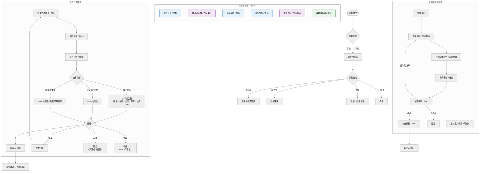

# 流程图：商机到立项全流程

> 基于项目代码 `src/models/types.ts`、`src/models/initiation.ts`、`src/models/opportunities.ts`、`src/models/presales.ts`、`src/models/estimates.ts`、`src/models/early-investments.ts` 及对应 `src/mock/` 业务逻辑梳理。

---

## 一、全景流程



---

## 二、分阶段详细流程

### 2.1 商机管理阶段

#### 商机状态

`草稿` → `待评估` → `拟立项` → `方案评审中` → `已转立项`

其他终态：`跟进中` / `暂缓` / `已终止`

#### 参与角色

| 角色 | 操作 | 动作类型 |
|---|---|---|
| **市场主办** | 创建/编辑商机 | `save-opportunity` |
| **市场主办** | 提交商机（→待评估） | `save-opportunity` + submit |
| **市场主办** | 发起评估 | `start-opportunity-assessment` |
| **市场主办** | 客户价值评分 | `save-opportunity-dimension: customer` |
| **方案架师** | 技术可行性评分 | `save-opportunity-dimension: technology` |
| **市场主办** | 商务风险评分 | `save-opportunity-dimension: commercial` |
| **市场主办** | 竞争态势评分 | `save-opportunity-dimension: competition` |
| **方案架师** | 交付难度评分 | `save-opportunity-dimension: delivery` |
| **财务专员** | 收益与毛利评分 | `save-opportunity-dimension: margin` |
| **市场主办** | 评估结论决策 | `conclude-opportunity` |
| **市场主办** | 填写跟进记录 | `follow-opportunity` |

#### 关键规则

- **评估门槛**：综合评分 ≥ 70 分 **且** 预估毛利率 ≥ 20% 方可拟立项
- **阻断条件**：技术可行性为"不可行"直接阻断
- **拟立项后**：自动产生"方案编制任务"（责任人：方案架师）

---

### 2.2 售前方案与技术评估阶段

#### 商机状态

`拟立项` → `方案评审中` → `拟立项`

#### 参与角色

| 角色 | 操作 | 动作类型 |
|---|---|---|
| **市场主办 / 方案架师** | 记录调研 | `presales-research` |
| **方案架师** | 保存方案 | `presales-save-solution` |
| **方案架师** | 技术成本测算 | `presales-save-cost` |
| **财务专员** | 财务审查成本 | `presales-finance-check` |
| **PMO** | 发起评审 | `presales-submit-review` |
| **方案架师** | 技术专家评审 | `presales-expert-opinion` |
| **财务专员** | 财务专家评审 | `presales-expert-opinion` |
| **PMO** | 评审综合决断 | `presales-review-decision` |
| **整改责任人** | 整改回复 | `presales-correction-reply` |

#### 关键检查项（评审发起前）

| 检查项 | 说明 |
|---|---|
| 方案完整性 | 客户现状、建设目标、范围、交付边界、总体架构、实施思路、交付物、外部依赖、关键假设 |
| 方案附件 | 正式方案附件必传 |
| 成本测算 | 科目明细必填；技术结论不可行阻断 |
| 财务确认 | 财务已审查当前成本版本 |
| 采购询价时效 | SUB-03 科目询价未过期 |
| 无正在处理的评审 | 已有评审中状态阻断 |
| 整改回复完整 | 上轮整改已逐条回复 |

#### 评审结论

- **通过**：方案任务标记为已完成，进入概算冻结
- **整改后复审**：产生整改事项重新回复
- **不通过**：流程终止

---

### 2.3 概算编制阶段

可在方案评审后并行，但**冻结**必须在方案评审通过后。

#### 参与角色

| 角色 | 操作 | 动作类型 |
|---|---|---|
| **方案架师 / 财务专员** | 创建概算草稿 | `estimate-create-draft` |
| **方案架师 / 财务专员** | 保存草稿 | `estimate-save-draft` |
| **方案架师 / 财务专员** | 发布版本 | `estimate-publish` |
| **PMO** | 冻结概算 | `estimate-freeze` |

#### 依赖

- 科目配置（`configuration-finance`）
- 人力单价费率（`labor.hourlyRate`）

> 冻结后的概算版本链：`要求兴奋剂 estimate.id === 商机 currentEstimateVersionId` 且 `estimateMeta.reviewId === 方案评审ID && solutionVersionId === 成本版本.solutionVersionId`

---

### 2.4 提前投入管理（可选阶段）

在正式立项前，可申请提前投入成本。

#### 参与角色

| 角色 | 操作 | 动作类型 |
|---|---|---|
| **市场主办** | 保存提前投入申请 | `save-early-investment` |
| **PMO / 集团领导** | 审批（依金额） | `review-early-investment` |
| **财务专员** | 记录实际成本 | `record-early-cost` |

---

### 2.5 正式立项阶段

#### 前置条件

1. 商机处于 `拟立项`
2. 方案及专家评审已通过（`presales.reviews[].status === '通过'`）
3. 商机已指定冻结概算版本（`opportunity.currentEstimateVersionId`）
4. 版本链一致（概算 ← 评审 → 方案版本）
5. 商机尚未关联正式项目

#### 参与角色

| 角色 | 操作 | 动作类型 |
|---|---|---|
| **市场主办** | 保存/提交立项申请 | `save-initiation` / `submit-initiation` |
| **PMO** | 风险评估 | `assess-initiation-risk` |
| **PMO** | 项目分级 | `classify-initiation` |
| **方案架师** | 会签（技术节点） | `sign-initiation` |
| **PMO** | 会签（法务协同、PMO节点） | `sign-initiation` |
| **财务专员** | 会签（财务节点） | `sign-initiation` |
| **市场主办** | — | 不参与会签 |
| **集团领导** | PMC决策会终审 | `decide-initiation` |
| **PMO** | PMO立项会决策 | `decide-initiation` |
| **PMO** | 恢复暂缓申请 | `resume-initiation` |

#### 项目分级规则

| 条件 | 级别 | 决策路径 |
|---|---|---|
| 金额 ≥ 10000 万元 | **特大型** | PMC决策会 |
| 金额 ≥ 5000 万元 | **重大** | PMC决策会 |
| 金额 ≥ 2000 万元 | **重点** | PMO立项会 |
| 其他 | **一般** | 线上会签 |
| 战略项目 | 自动升一档 | — |
| 综合风险为高 | 升到PMC决策会 | — |

#### 会签节点（线上会签路径）

| 序号 | 节点 | 签署角色 |
|---|---|---|
| 1 | 技术 | 方案架师 |
| 2 | 方案 | 方案架师 |
| 3 | 交付 | 项目经理 |
| 4 | 财务 | 财务专员 |
| 5 | 法务协同（PMO代办） | PMO |
| 6 | PMO | PMO |

> 任一节点"否决"触发整改流程

#### 决策结果

| 结果 | 后续 |
|---|---|
| **通过** | → 创建 Project 实体（立项阶段/WBS编制）→ 继承提前投入 → 商机标记"已转立项" |
| **整改** | → 市场主办补充修改后重新提交 |
| **否决** | → 商机标记"已终止" → 记录沉没成本处置 |
| **暂缓** | → 商机标记"暂缓" → PMO 可凭复评说明恢复 |

#### 立项通过后自动生成

| 产出 | 说明 |
|---|---|
| **Project 项目实体** | 阶段：`立项`，子阶段：`WBS编制` |
| **计划草稿** | 含里程碑模板 |
| **团队** | 等待 PMO 任命 |
| **资料清单** | 范围说明书、实施计划、测试报告等 |
| **已签合同绑定** | 如合同已签，自动绑定项目并记入合同金额 |

---

## 三、角色全景

| 角色 | 代码标识 | 在商机→立项中的参与 |
|---|---|---|
| **市场主办** | `market` | 商机创建/评估/结论、方案调研、立项提交、提前投入 |
| **方案架构师** | `solution-tech` | 技术评估、方案编制、成本测算、专家评审、会签 |
| **财务专员** | `finance` | 毛利评估、成本审查、概算编制、会签 |
| **PMO** | `pmo` | 发起评审、决断、风险评估、分级、会签、决策 |
| **集团领导** | `executive` | 重大/高风险立项终审、高管审批 |
| **项目经理** | `project-manager` | 会签（交付节点）、立项后团队接收 |
| **系统管理员** | `admin` | 规则与权限配置（不参与业务） |

---

## 四、关键数据结构

### 商机（Opportunity）

```typescript
interface Opportunity {
  id: string;
  name: string;
  customerId: string;
  ownerId: string;
  departmentId: string;
  estimatedAmount: number;      // 万元
  status: '草稿' | '待评估' | '拟立项' | '跟进中' | '方案评审中' | '已转立项' | '暂缓' | '已终止';
  winRate: number;              // 0-100
  currentEstimateVersionId?: string;
  earlyInvestmentQuota: number; // 提前投入限额
  earlyInvestmentUsed: number;
}
```

### 立项申请（InitiationApplication）

```typescript
interface InitiationApplication {
  id: string;
  input: InitiationInput;          // 基本情况、范围、计划
  rounds: InitiationRound[];       // 评审轮次
  status: '草稿' | '待风险评估' | '待分级' | '会签中' | '待决策' | '通过' | '整改' | '否决' | '暂缓';
  projectId?: string;              // 立项通过后生成
}
```

### 项目（Project，立项通过后创建）

```typescript
interface Project {
  id: string;
  opportunityId: string;
  phase: '商机' | '立项' | '执行' | '收尾' | '运维' | '已关闭';
  subPhase: '初步评估' | ... | 'WBS编制' | ...;
  isUnsigned: boolean;             // 是否未签立项
  pmId: string;
  contractAmount: number;
  budgetAmount: number;
}
```

---

## 五、版本链关系

```
┌─────────────────────────────────────────────────────┐
│                    版本链一致性                        │
│                                                       │
│  方案版本 ──→ 成本版本 ──→ 评审记录 ──→ 概算冻结      │
│  (solution)    (cost)       (review)     (estimate)   │
│     │             │            │             │        │
│     └─────────────┴────────────┴─────────────┘        │
│                        │                              │
│                   estimateMeta:                       │
│                   reviewId ✓                          │
│                   solutionVersionId ✓                 │
│                   costVersionId ✓                     │
│                        │                              │
│                   opportunity.                         │
│                   currentEstimateVersionId ✓          │
└─────────────────────────────────────────────────────┘
```

> 版本链不一致时，`initiationPrerequisites` 会阻断立项提交。

---

## 六、关键阈值一览

| 阈值 | 值 | 定义位置 |
|---|---|---|
| 商机评估最低评分 | 70 分 | `OPPORTUNITY_RULE.minimumScore` |
| 最低毛利率 | 20% | `OPPORTUNITY_RULE.minimumMargin` |
| 重大金额 | ≥ 5000 万 | `INITIATION_RULE.majorAmount` |
| 特大型金额 | ≥ 10000 万 | `INITIATION_RULE.superAmount` |
| 重点金额 | ≥ 2000 万 | `INITIATION_RULE.keyAmount` |
| 高风险评分 | 风险概率×影响 ≥ 16 | `INITIATION_RULE.highRiskScore` |
| 中风险评分 | ≥ 9 | `INITIATION_RULE.mediumRiskScore` |
| 最低立项毛利率 | 20% | `INITIATION_RULE.minimumMargin` |