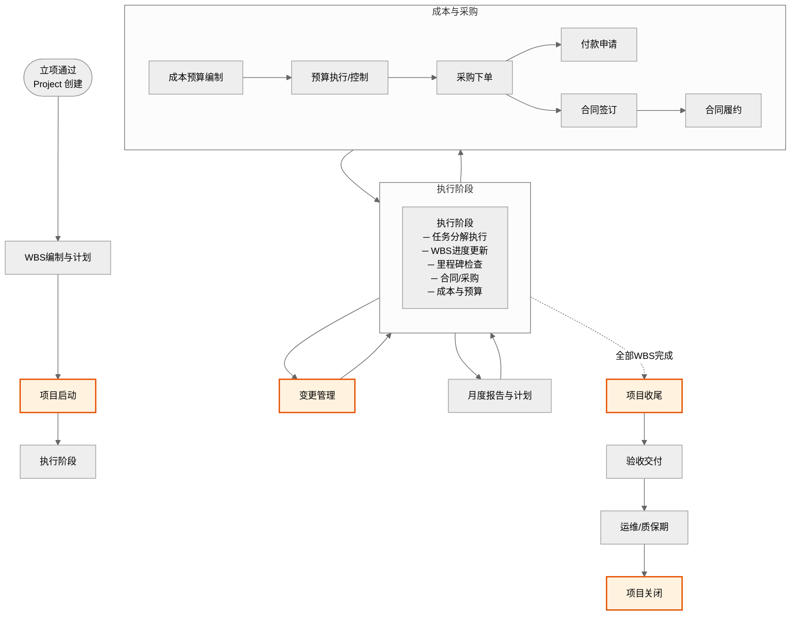
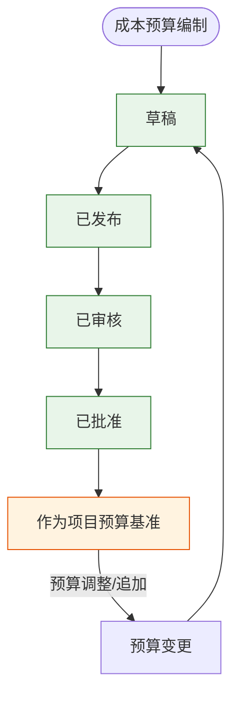
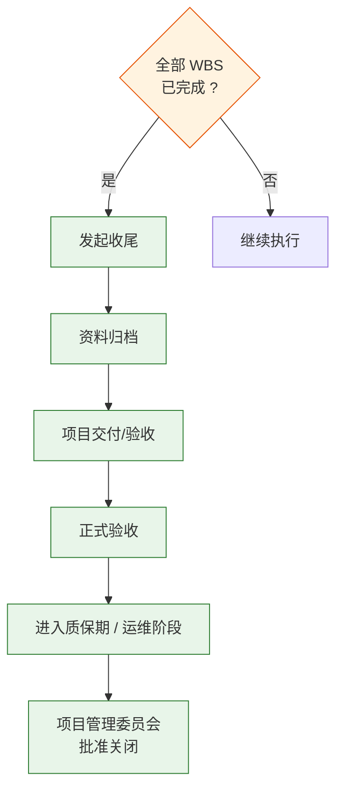

# 流程图：立项到执行全流程

> 基于项目代码 `src/models/types.ts`（Project/Milestone/WbsTask/CostBudget/BudgetLine/PurchaseOrder/K3Acct/Vendor）、`src/models/projects.ts`、`src/models/cost-budgets.ts`、`src/models/budget.ts`、`src/models/purchase-orders.ts`、`src/models/closeout.ts` 及对应 `src/mock/` 业务逻辑梳理。

---

## 一、全景流程



---

## 二、分阶段详细流程

### 2.1 阶段总览

Project 的生命周期阶段及子阶段：

| 阶段 | 子阶段 |
|---|---|
| **商机** | 初步评估、商务推进 |
| **立项** | 立项申请、WBS编制 |
| **执行** | 项目启动、需求分析、设计开发、系统测试、上线准备、上线验收 |
| **收尾** | 项目收尾 |
| **运维** | 运维管理（含质保期） |
| **已关闭** | — |

> 立项通过时 Project 创建，阶段为 `立项`，子阶段为 `WBS编制`。

---

### 2.2 WBS编制与项目计划

Project 创建后自动初始化：

| 产出 | 说明 |
|---|---|
| **计划草稿** | 含里程碑模板：需求评审 → 设计评审 → 系统测试 → 上线验收 |
| **资料清单模板** | 范围说明书、实施计划、需求文档、设计文档、测试报告、培训资料 |
| **团队初始** | 等待 PMO 正式任命 |

#### 参与角色

| 角色 | 操作 |
|---|---|
| **项目经理（pm）** | 细化 WBS 分解，设定里程碑，指定任务责任人 |
| **PMO** | 确认 WBS 与计划完整性 |
| **各专业负责人** | 确认本域 WBS 估算工时与依赖 |

---

### 2.3 执行阶段

#### 2.3.1 WBS 任务执行


**WBS 任务状态**：`待开始` → `进行中` → `已完成`

| 角色 | 操作 | 动作类型 |
|---|---|---|
| **项目经理** | 创建/编辑 WBS 任务 | 通过 Project 初始化 |
| **任务负责人** | 更新任务进度 | `update-wbs-progress` |
| **项目经理** | 检查里程碑 | `check-milestone` |

#### 2.3.2 里程碑管理

里程碑附着在计划上，关键里程碑包括：

| 里程碑 | 触发条件 |
|---|---|
| 需求评审 | 需求分析阶段完成 |
| 设计评审 | 设计阶段完成 |
| 系统测试 | 测试阶段启动 |
| 上线验收 | 上线准备完成 |

---

### 2.4 成本与预算管理

#### 2.4.1 成本预算



**成本预算状态**：`草稿` → `已发布` → `已审核` → `已批准`（一级/二级审批）

| 角色 | 操作 | 动作类型 |
|---|---|---|
| **财务专员（finance）** | 编辑成本预算 | `save-cost-budget` |
| **财务专员** | 发布预算 | `publish-cost-budget` |
| **PMO** | 一审审批（一级审批） | `approve-cost-budget` |
| **集团领导（executive）** | 二审审批（二级审批，金额门槛可配置） | `approve-cost-budget` |

> 预算科目参照概算科目配置（`configuration-finance`），含人力、差旅、设备、采购等。

#### 2.4.2 预算行项目

| 字段 | 说明 |
|---|---|
| `budgetId` | 归属预算 ID |
| `科目` | 对应配置中的费用科目 |
| `amount` | 预算金额 |
| `usedAmount` | 已用金额（关联采购订单/付款） |
| `balance` | 可用余额 |

#### 2.4.3 预算余额保护

```
余额 = amount - usedAmount
下单时：采购金额 ≤ 余额（否则阻塞）
```

---

### 2.5 采购下单

#### 采购订单状态

`草稿` → `已审批` → `已下单` → `部分交付` → `已完成` → `已关闭`

#### 参与角色

| 角色 | 操作 | 动作类型 |
|---|---|---|
| **项目经理（pm）** | 创建采购订单草稿 | `save-purchase-order` |
| **项目经理** | 提交审批 | `submit-purchase-order` |
| **PMO** | 审批采购订单 | `approve-purchase-order` |
| **财务专员** | 审批采购订单 | `approve-purchase-order` |
| **供应商** | — | 外部角色，系统只记录 |

#### 采购订单数据

```typescript
interface PurchaseOrder {
  id: string;
  projectId: string;
  vendorId: string;
  items: PurchaseOrderItem[];    // 行项目（科目 + 金额 + 数量）
  status: PurchaseOrderStatus;
  contractId?: string;           // 关联合同
  budgetLines: string[];         // 关联预算行 ID
}
```

#### 采购审批路径

| 条件 | 审批人 | 审批级别 |
|---|---|---|
| 金额 ≤ 10万 | PMO | 一级审批 |
| 金额 > 10万 | PMO + 集团领导 | 二级审批 |

> 规则文件：`src/models/purchase-orders.ts`

---

### 2.6 合同管理

#### 合同状态

`草稿` → `待我方签署` → `待客户签署` → `已生效` → `履约中` → `已完成` → `已终止`

#### 参与角色

| 角色 | 操作 |
|---|---|
| **项目经理** | 创建合同草稿，关联采购订单 |
| **法务/PMO** | 合同条款审核与签署 |
| **财务专员** | 付款条件与金额核对 |

---

### 2.7 变更管理

任何对审批通过的 **范围 / 计划 / 资源** 的调整均走变更流程。

| 步骤 | 角色 | 说明 |
|---|---|---|
| 提交变更申请 | **项目经理** | 描述变更内容和理由 |
| 影响分析 | **方案架师 / 财务** | 技术影响、成本影响 |
| 审批 | **PMO / 集团领导（按金额）** | 分级审批 |
| 执行变更 | **项目经理** | 更新 WBS、成本预算、计划 |
| 记录归档 | **PMO** | 变更日志保存 |

---

### 2.8 月度报告与计划

#### 参与角色

| 角色 | 操作 | 说明 |
|---|---|---|
| **项目经理** | 提交月度报告 | 本月完成、下月计划、风险与问题 |
| **各负责人** | 填报实际工时/成本 | 关联 WBS 任务 |
| **PMO** | 审核报告 | 分析偏差，给出指导 |

---

### 2.9 项目收尾

#### 前置条件

- 全部 WBS 任务为 `已完成`
- 所有里程碑已检查通过
- 所有采购订单已处理（已完成/已关闭）
- 成本预算已执行完毕

#### 收尾流程



#### 参与角色

| 角色 | 操作 | 动作类型 |
|---|---|---|
| **项目经理** | 发起收尾 | `initiate-closeout` |
| **PMO** | 审核收尾资料 | `review-closeout` |
| **集团领导 / PMC** | 批准项目关闭 | `approve-closeout` |
| **财务专员** | 完成财务结算 | `settle-closeout` |

#### 财务结算

| 操作 | 说明 |
|---|---|
| 盘活余额 | 未使用的预算余额回收到资源池 |
| 合同尾款 | 按合同约定触发尾款支付 |
| 成本决算 | 实际成本 vs 预算成本对比分析 |

---

### 2.10 运维 / 质保期

收尾通过后项目进入**运维阶段**（子阶段：`运维管理`）。

| 时段 | 说明 |
|---|---|
| **质保期（通常1年）** | 原团队负责免费运维 |
| **正式运维** | 可转入运维团队或第三方 |
| **项目关闭** | 运维到期经 PMC 批准后关闭 |

---

## 三、参与角色全景

| 角色 | 代码标识 | 在执行阶段职责 |
|---|---|---|
| **项目经理** | `project-manager` | WBS编制、计划、任务分配、进度控制、采购下单、月度报告、收尾发起 |
| **PMO** | `pmo` | 预算审批、采购审批、变更审批、收尾审核、资料归档监督 |
| **财务专员** | `finance` | 成本预算编制/审批、付款审核、财务结算 |
| **方案架构师** | `solution-tech` | 变更影响分析、技术方案偏离审核 |
| **集团领导** | `executive` | 高级别采购审批、二级预算审批、重大变更审批、项目关闭批准 |
| **任务负责人** | 各域专业角色 | WBS 任务执行与进度更新 |
| **法务** | — | 合同条款审核、签署（通过 PMO 协同） |

---

## 四、关键数据结构

### 项目（Project）

```typescript
interface Project {
  id: string;
  opportunityId: string;
  phase: '商机' | '立项' | '执行' | '收尾' | '运维' | '已关闭';
  subPhase: string;          // 见上表子阶段
  isUnsigned: boolean;       // 是否未签合同先行立项
  pmId: string;              // 项目经理 ID
  pmName: string;
  departmentId: string;
  clientId: string;
  planStartDate: string;
  planEndDate: string;
  actualStartDate?: string;
  contractAmount: number;    // 合同金额
  budgetAmount: number;      // 预算金额
}
```

### WBS 任务（WbsTask）

```typescript
interface WbsTask {
  id: string;
  projectId: string;
  parentId: string;           // WBS 层级
  name: string;
  assigneeId: string;
  planStart: string;
  planEnd: string;
  actualStart?: string;
  actualEnd?: string;
  status: '待开始' | '进行中' | '已完成';
  progress: number;           // 0-100
  estimatedHours: number;
  actualHours: number;
}
```

### 成本预算（CostBudget）

```typescript
interface CostBudget {
  id: string;
  projectId: string;
  version: number;
  status: '草稿' | '已发布' | '已审核' | '已批准';
  items: BudgetLine[];
  totalAmount: number;
  totalUsed: number;
  approvalChain: ApprovalRecord[];
}
```

### 采购订单（PurchaseOrder）

```typescript
interface PurchaseOrder {
  id: string;
  projectId: string;
  vendorId: string;
  items: { categoryId: string; name: string; amount: number; quantity: number; }[];
  totalAmount: number;
  status: PurchaseOrderStatus;
  contractId?: string;
  budgetLines: string[];
}
```

### 收尾（Closeout）

```typescript
interface Closeout {
  projectId: string;
  status: '待发起' | '验收中' | '已结算' | '质保期' | '已关闭';
  deliverables: DeliverableRecord[];
  settleAmount: number;
  handoverDate: string;
}
```

---

## 五、状态流转图

```
立项通过
    │
    ▼
[WBS编制]  ───  WbsTask 分解，里程碑初始化
    │
    ▼
[项目启动]
    │
    ▼
┌──────────────────────────────────────────────────────┐
│                     执行阶段                          │
│                                                       │
│  WBS 任务：待开始 → 进行中 → 已完成                   │
│  里程碑检查：定时触发                                  │
│  月度报告：项目经理每月提交                             │
│  变更管理：范围/计划/资源变更，分级审批                 │
│                                                       │
│  成本与采购：                                         │
│    ┌─ 成本预算: 草稿→已发布→已审核→已批准              │
│    ├─ 采购订单: 草稿→已审批→已下单→部分交付→已完成     │
│    ├─ 合同管理: 草稿→签署→履约→完成                   │
│    └─ 付款申请: 按订单/合同发起                        │
│                                                       │
└──────────────────────────────────────────────────────┘
    │  (全部 WBS 已完成)
    ▼
[项目收尾]  ───  资料归档 / 正式验收 / 财务结算
    │
    ▼
[运维/质保期]  ───  质保运维（通常1年）
    │
    ▼
[项目关闭]  ───  PMC 批准关闭
```

---

## 六、与立项阶段的衔接

| 立项时初始化 | 执行时所有权转移 |
|---|---|
| 计划草稿（里程碑模板） | 项目经理细化 WBS 和计划 |
| 初始团队 | PMO 正式任命团队角色 |
| 资料清单模板 | — |
| 概算→预算导入 | 财务专员按科目展开成本预算 |
| 提前投入成本 | 财务记录实际成本时关联回立项阶段 |

> **版本链**：执行阶段的预算应关联回立项阶段的概算版本，形成"概算→预算→决算"闭环。